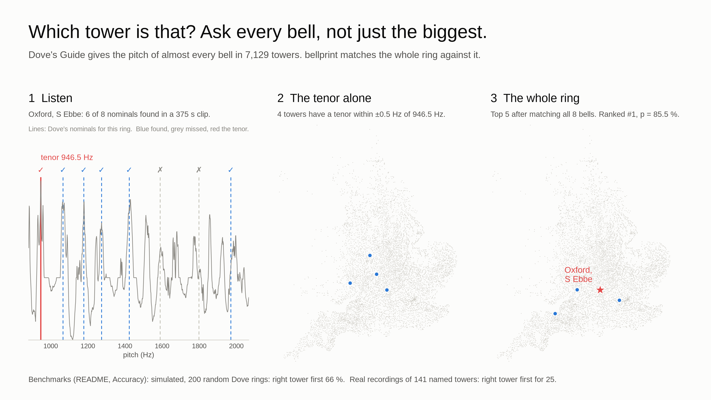

# bellprint



[](https://github.com/Hexay/bellprint/actions/workflows/ci.yml)
[](https://pypi.org/project/bellprint/)
[](LICENSE)

Work out which church tower you can hear in a recording, from the pitches of its bells.

**Status: early research software.** On simulated recordings it puts the right tower first about seven times
in ten; on real recordings, nearly one time in three. See [Accuracy](#accuracy).

## Why the whole ring

[Dove's Guide](https://dove.cccbr.org.uk/) lists about 7,000 rings of bells and, for most bells, the frequency
of its *nominal*, the partial that sets its pitch. The biggest bell (the tenor) on its own is not a fingerprint:
5,976 English rings with a recorded tenor share just 1,553 distinct frequencies, and a typical tenor matches 19
towers to within ±0.5 Hz.

A whole ring is far more distinctive: how many bells, the intervals between them, and their absolute pitch.
bellprint matches all of that against Dove's per-bell nominals (46,983 bells; 6,362 rings with every bell
measured).

## Quick start

```bash
pip install bellprint
bellprint locate recording.flac
bellprint locate recording.mp3 --near 51.75,-1.26,20 --start 12 --end 40 --json
```

| Option | Does |
|---|---|
| `--near lat,lon[,km]` | Only consider towers in this circle (default radius 30 km) |
| `--use-geotag` | Use the GPS position in the file's own metadata (MP4/MOV/M4A/3GP, FLAC) as `--near` with the default radius; `--near` wins |
| `--start`, `--end` | Seconds of the file to analyse; pick the part where bells ring |
| `--top N` | How many candidates to list |
| `--json` | Full report: spectral lines, candidates, scores, confidence |

Audio is decoded natively: WAV, FLAC, MP3, AAC/M4A, Ogg Vorbis. A snapshot of Dove's data is built in; point
`--dove` at a directory with a newer `dove.csv` and `bells.csv` to use those instead. From Python,
`bellprint.locate("recording.flac", near="51.75,-1.26,20")` returns the same report as a dict. Prebuilt wheels
cover Linux, macOS and Windows; from a checkout, `cargo run --release -p bp-cli -- locate ...` does the same.

## How it works

1. **Lines.** Average the clip's power spectrum over time (Welch), which keeps the short-lived nominals of
   every blow even when the bells sound in only part of the clip; if loud noise leaves too few lines, fall
   back to a high percentile over time. Keep the lines up to 2.5 kHz that stand out
   from a moving-median floor; bells pitched above that are skipped rather than counted as missing.
2. **Bell model.** Each bell predicts lines at its hum, prime, tierce, quint, nominal, superquint and octave
   nominal, with tolerances in cents from published bell measurements ([research/acoustics.md](research/acoustics.md)).
   Bells cast from 1896, when true-harmonic tuning began, get much tighter hum and prime tolerances.
3. **Match.** Score every Dove ring on how many of its nominals are present and how well its predicted
   partials explain the observed lines, compared with chance. Bands often ring only the back or front bells
   of a larger ring, so those subsets are scored too, at a small penalty. One pitch shift is fitted per clip,
   with priors at the offsets that 44.1/48 kHz and 24/25 fps mix-ups produce, sharply peaked because most
   real clips sit within a few cents of one of them.
4. **Rank.** List candidate towers with relative probabilities and the top candidate's margin over the next.
   The probabilities are not calibrated: too cautious on clean audio, too confident on real recordings
   ([research/matcher.md](research/matcher.md)). Instead the top pick gets a coarse confidence from its
   margin: **high** (≥ 2 nats) is right 98 % of the time on simulated recordings and 81 % on real ones,
   **medium** (1–2) 76 % / 48 %, **low** (< 1) 37 % / 13 %. Thresholds were set on the simulation and
   the real-recording rates are held out ([research/matcher_twins.md](research/matcher_twins.md)).

Two experimental options did worse than this default and stay opt-in: `--extraction blows` (keep only lines
that rise when a bell strikes) and `--auto-window` (analyse only the most bell-like 10 s windows).

## Accuracy

| Benchmark | Setup | Right tower first | In top 5 |
|---|---|---|---|
| Simulated, 200 random Dove rings | 8 s of rounds, 10 dB SNR, distractor tones, ±8 c speed and ±3 c Dove error, 5 % of rings retuned, hum and prime spread by each bell's tuning era | **72 %** | 88 % |
| Real recordings of 141 named towers ([data/corpus](data/corpus/README.md)) | Whole clips as published, no `--near` | **46 / 141** | 66 / 141 |

- The simulator shares no code or constants with the matcher's bell model, but it is kinder than reality: no
  reverb, no automatic gain control, and ringing for the whole clip.
- Every real hit is far above chance (about 1 in 7,000 per clip), but most real clips still miss.
  Chimes, clock bells and carillons are largely absent from Dove and can't match at all.
- The viral claim that a few seconds of the tenor identify a tower has not been reproduced, and its original
  post could not be traced ([research/prior_work.md](research/prior_work.md)).

## Development

See [CONTRIBUTING.md](CONTRIBUTING.md). Sourced background research is in [research/](research/README.md);
the header is drawn by `tools/readme_figure.py` from a real corpus clip.

## Responsible use

This tool can place a recording, and so the person who made it, on a map. Use it on your own recordings, on
material published for this purpose, or with the recordist's consent. Don't use it to find, track or expose
people. `--use-geotag` reads location metadata only from the file you pass, and only when you ask.

## Credits and data

- Bell data: [Dove's Guide for Church Bell Ringers](https://dove.cccbr.org.uk/), © Central Council of Church
  Bell Ringers, [CC BY-SA 4.0](https://creativecommons.org/licenses/by-sa/4.0/). The files in `data/dove/` keep
  that licence ([data/dove/README.md](data/dove/README.md)). Not endorsed by the Central Council.
- Bell acoustics: Bill Hibbert's published measurements and thesis, among the sources in [research/](research/).
- Real-recording corpus: links to recordings on Freesound, archive.org (including Radio Aporee), BBC Sound
  Effects, SoundCloud and Vimeo, credited per entry in the manifests. No audio is redistributed.
- Structure follows [dopplerprint](https://github.com/Hexay/dopplerprint).

## Licence

Code: MIT, see [LICENSE](LICENSE). Data keeps its own licence (above).
